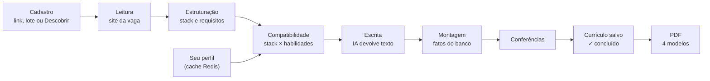
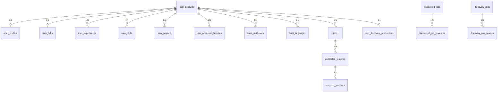
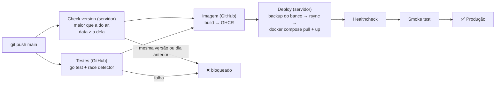

# JobPipeline

> Do link da vaga ao currículo sob medida em PDF — com IA que escreve, mas não inventa.

| CI/CD | Demo |
| :--- | :--- |
| [](https://github.com/ZeroPirata/jubilant-fishstick/actions/workflows/deploy.yml) | [](https://gerador-curriculo.gsbnunes.com.br) |

O JobPipeline lê uma vaga, compara com o seu perfil e monta um currículo (e, se quiser, a carta de apresentação) adaptado àquela vaga, em português ou inglês, pronto em PDF. Ele também mantém um catálogo próprio de vagas de tecnologia — o **Descobrir** — ordenado pelo quanto cada vaga combina com o que você sabe.

É também um laboratório de engenharia em **Go**: worker concorrente, arquitetura em camadas (handlers → repositórios → sqlc), cache, tempo real por SSE, observabilidade e deploy contínuo num servidor próprio.

**Sumário:** [Como usar](#como-usar) · [Como pensamos](#como-pensamos) · [O caminho de uma vaga](#o-caminho-de-uma-vaga) · [Descobrir](#descobrir-o-catálogo-de-vagas) · [Importar currículo](#importar-currículo) · [Painel admin](#painel-admin) · [Arquitetura](#arquitetura) · [Dados](#dados) · [Segurança](#segurança) · [Observabilidade](#observabilidade) · [Versões e deploy](#versões-e-deploy) · [API](#api) · [Rodando localmente](#rodando-localmente) · [Estrutura](#estrutura-do-projeto)

---

## Como usar

1. **Monte o perfil.** Importe o currículo que você já tem (PDF, DOCX, TXT ou o PDF do LinkedIn) ou cadastre experiências, habilidades (com nível), projetos, formação, certificados e idiomas. Tudo que vai para o currículo sai daqui.
2. **Escolha a vaga.** Cole o link em *Nova vaga* (ou vários de uma vez, no lote) ou encontre uma no **Descobrir** e clique em *Gerar currículo*. Escolha o idioma e o que gerar: currículo e carta, só currículo ou só carta.
3. **Acompanhe.** A lista de vagas se atualiza sozinha enquanto a vaga é lida, analisada e escrita.
4. **Abra a vaga.** A tela da vaga tem quatro abas: *Compatibilidade* (análise da IA e stack × perfil), *Palavras-chave* (termos da vaga × último currículo × perfil, sem IA, para filtros de ATS), *Currículos e cover letters* e *Sobre a vaga*. O endereço (`#/vaga/<id>`) pode ser salvo e sobrevive ao F5.
5. **Baixe e avalie.** Gere o PDF em um dos quatro modelos e avalie o resultado: as avaliações ensinam o sistema a escrever do seu jeito.

A aba **Ajuda**, dentro do app, explica tudo isso passo a passo, inclusive o que acontece por dentro.

---

## Como pensamos

Algumas decisões guiam o produto inteiro. Elas explicam boa parte do código.

| Princípio | Na prática |
|---|---|
| **A IA escreve; os fatos são seus.** | A IA recebe só o seu perfil e devolve **texto** (resumo, tópicos, carta, análise), citando experiências e projetos por id. Empresa, cargo, datas, formação e contato são montados pelo código a partir do banco (`internal/resume`). A IA não consegue mudar um fato. |
| **Nada é inventado.** | Conferências automáticas antes de entregar: resumo que cita tecnologia fora do perfil volta para correção; ponto forte com tecnologia que você não tem é removido; tradução que "promove" o cargo é descartada. |
| **Você decide.** | Compatibilidade e análise só informam. O currículo é gerado em qualquer nível de aderência. |
| **Cota de IA é recurso escasso.** | Resposta da IA guardada por hash do pedido; trocar o modelo do PDF não chama a IA; pausa automática quando o provedor limita. |
| **Fontes com respeito.** | Vagas só de APIs e quadros públicos, sem login de terceiros e sem burlar bloqueios. O link leva sempre à vaga original. Detalhes em [`docs/fontes.md`](docs/fontes.md). |
| **Um cálculo, uma verdade.** | A compatibilidade (`internal/jobfit`) é a mesma na lista de vagas, na tela da vaga e no Descobrir: a nota nunca diverge da tela. |

---

## O caminho de uma vaga



**1. Cadastro.** A vaga entra em `jobs` com status `pending`, idioma (`pt-br`/`en`) e modo (`full`, `resume_only`, `cover_only`). O cadastro avisa se o perfil está fraco (sem habilidades, sem experiências e projetos…), sem bloquear.

**2. Leitura** (`scraping_basic`). Um leitor por site (`internal/scraper`): LinkedIn, Gupy, ProgramaThor, Jobright, Amazon, GeekHunter, os ATS (Greenhouse, Lever, Ashby…) e um leitor genérico que entende o `JobPosting` (JSON-LD) presente em muitos sites. Se o usuário colou a descrição, ela vale e o site nem é aberto. Se o site bloquear e a vaga veio do Descobrir, usa a descrição guardada no catálogo.

**3. Estruturação** (`scraping_nl`). Uma chamada leve à IA extrai `stack[]`, `requisitos[]` e uma descrição limpa. Os nomes são normalizados por aliases (`Golang → Go`, `Postgres → PostgreSQL`).

**4. Seleção do perfil e compatibilidade.** O worker lê o perfil (com cache no Redis por tópico, invalidado a cada edição) e calcula a compatibilidade: a cobertura da stack da vaga pelas suas habilidades, **pesando o nível** (expert/avançado 100%, intermediário 75%, básico 40%). Alta a partir de 70%, média a partir de 30%.

**5. Escrita.** O prompt é um JSON com a vaga, as experiências (até 4 conquistas cada), projetos, habilidades, formação, o modo e — para aprender com você — o último currículo avaliado como *Excelente* e os comentários recentes das avaliações. A IA devolve resumo, tópicos por experiência, agrupamento de habilidades, carta e a análise da vaga (pontos fortes, lacunas, recomendação).

> **Cache da resposta:** o pedido é identificado por um hash do prompt de sistema + prompt do usuário. Se nada mudou (vaga, perfil, avaliações, idioma, modo, versão do prompt), a resposta guardada no Redis por 30 dias é reaproveitada. No *Refazer*, a opção **Nova versão da IA** (marcada por padrão) ignora o cache.

**6. Montagem.** `resume.Assemble` junta o texto da IA com os fatos do banco num documento estruturado (`Doc`, versão 2): cabeçalho com contato e links, experiências com empresa/cargo/datas reais, formação, certificados e idiomas. Em inglês, cargos e habilidades são traduzidos — mas uma tradução que acrescenta nível ("Júnior" → "Senior"), gestão, números ou palavras demais é descartada e o original fica.

**7. Conferências.** Resumo que cita tecnologia que a vaga pede e você não tem, ou anos de experiência em primeiro emprego, volta para a IA com instruções de correção; o que continuar errado é cortado frase a frase. Pontos fortes da análise que citam tecnologia fora do perfil são removidos.

**8. PDF.** Gerado sob demanda por um servidor WeasyPrint persistente (`scripts/gerar_pdf.py`) em quatro modelos: Clássico, Executivo, Compacto (1 página) e Primeiro emprego. Trocar de modelo só reformata.

**Resiliência do worker:** ciclo configurável (padrão 30 s, até 5 vagas em paralelo); leitura e seleção do perfil rodam em paralelo; HTTP 429 do provedor pausa a fila e devolve a vaga para `pending`; vagas presas em `processing` por mais que `WORKER_RECOVERY_TIMEOUT` voltam sozinhas para a fila.

---

## Descobrir: o catálogo de vagas

O Descobrir lê fontes públicas e mantém um catálogo próprio de vagas de tecnologia (`internal/discovery`).

| Tipo | Fontes |
|---|---|
| Busca por termo | Gupy |
| Listas | ProgramaThor, repositórios de vagas no GitHub, Himalayas (remotas abertas ao Brasil) |
| Quadros de empresas (ATS) | Greenhouse, Lever, Ashby, Workable, SmartRecruiters, Recruitee — empresas cadastradas no painel |

Cada fonte só entrou depois de verificar os termos de uso; as avaliadas e recusadas (LinkedIn, Remotive, APIs que exigem cartão) estão em [`docs/fontes.md`](docs/fontes.md).

**Varredura.** Automática a cada 12 h (intervalo configurável no painel), pelo botão do usuário com os termos dele, ou pelo admin. Pausa entre pedidos ao mesmo site, respeito ao `Retry-After`, limite de 60 s por pedido com uma nova tentativa em caso de lentidão. Só entram vagas no Brasil ou remotas abertas para cá.

**Indexação na entrada, não na leitura.** Ao gravar uma vaga, o sistema calcula as tecnologias citadas (`techs TEXT[]`, com regras de contexto: "go-to" não é Go), o idioma e o nível (júnior/pleno/sênior). Habilidades fora da lista de tecnologias ("APIs REST") são buscadas num `tsvector` do texto. As duas colunas têm índice GIN: a lista de 9 mil vagas sai em ~60–90 ms, contra ~0,6–1,8 s da versão que lia o texto a cada pedido.

**Ranking.** Todas as vagas candidatas são avaliadas pelo mesmo JobFit da aba Vagas e ordenadas por faixa de compatibilidade, tecnologias cobertas com nível forte, cobertura e coincidências. Cada linha mostra "62% da stack · você cobre 3 de 7 · falta: Kafka, AWS".

**Avisos de vagas novas.** O sininho no topo conta as vagas que entraram no catálogo (`first_seen_at`) desde a última olhada do usuário, com compatibilidade alta (ou alta e média, à escolha) e dentro do local e nível salvos. Usa o mesmo ranking da lista. Abrir o sininho ou o Descobrir avança a marca (`user_job_alerts.seen_at`): nenhuma vaga é avisada duas vezes. Por enquanto só na plataforma; Telegram e e-mail podem reaproveitar a mesma lista.

**Higiene do catálogo.** Vaga que some das buscas sai da lista em 36 h e é apagada em 7 dias; vaga publicada há mais de 45 dias não entra (e é removida, com log por fonte); vagas repetidas (mesmo título e empresa) aparecem uma vez.

---

## Importar currículo

O usuário envia um PDF, DOCX ou TXT (ou o PDF exportado do LinkedIn). A IA separa experiências, formação, habilidades, projetos, certificados e idiomas; o usuário revisa, ajusta níveis e escolhe o que salvar — itens já existentes vêm desmarcados para não duplicar. Cada importação fica registrada (modelos tentados, duração, motivo de falha) e aparece no painel admin.

---

## Painel admin

| Aba | O que mostra |
|---|---|
| Log de erros | Falhas de leitura, perfil vazio, erros e limites da IA, por vaga |
| Usuários | Contas, último acesso, quem é admin |
| Importações | Histórico de importações de currículo, ao vivo |
| Busca de vagas | Sites ligados, termos do catálogo, intervalo, empresas nos ATS (com busca por nome ou link em todos os ATS) |
| Configurações de IA *(master)* | Cadeia de provedores por finalidade (geração, leitura de vagas, importação), pausa do worker |
| Métricas | Vagas, IA (chamadas, latência, tokens), usuários e a varredura de vagas em andamento, por site |

O **admin master** vê também a versão do app no rodapé da barra lateral, com o selo "nova" quando há deploy novo.

---

## Arquitetura

```mermaid
graph TB
    Browser["Browser<br/>JS puro + SSE<br/>rotas #/aba"]
    API["API<br/>Go net/http"]
    Worker["Worker<br/>goroutines"]
    Disc["Descobrir<br/>varredura agendada"]
    DB[("PostgreSQL<br/>pgx v5 + sqlc<br/>migrations goose")]
    Cache[("Redis<br/>perfil, respostas da IA,<br/>revogação, pausa")]
    LLM["IA<br/>Gemini · Ollama ·<br/>OpenAI-compatible"]
    PDF["WeasyPrint<br/>processo persistente"]
    Sources["Fontes de vagas<br/>APIs públicas"]

    Browser -- "REST + SSE" --> API
    API --> DB
    API --> Cache
    Worker --> DB
    Worker --> Cache
    Worker -- "estrutura e escreve" --> LLM
    Worker -- "eventos" --> SSE["Bus SSE<br/>por usuário"] --> Browser
    Disc -- "lê" --> Sources
    Disc -- "upsert + índices" --> DB
    API -- "gera PDF" --> PDF
```



| Camada | Tecnologia |
|---|---|
| Backend | Go 1.26 — `net/http` puro, sem framework |
| Banco | PostgreSQL com `pgx v5`; queries em SQL compiladas pelo **sqlc**; migrations **goose** embutidas no binário e aplicadas na subida |
| Cache | Redis — perfil por tópico, respostas da IA, revogação de JWT, pausa por limite da IA |
| IA | Cadeia de provedores com fallback: Gemini, Ollama e qualquer API OpenAI-compatible (Groq, OpenRouter…), configurável no painel |
| PDF | WeasyPrint (Python), processo persistente |
| Frontend | HTML/CSS/JS sem framework; assets com `?v=<hash>` e cache imutável; rotas por hash |
| Tempo real | Server-Sent Events, bus em memória por usuário |
| Logs e métricas | Zap; Prometheus |
| Infra | Docker Compose (app, PostgreSQL, Redis) num servidor próprio, exposto por Cloudflare Tunnel |

---

## Dados



| Tabela | Para quê |
|---|---|
| `user_*` | Perfil: dados, links, experiências (stack, conquistas, tags), habilidades com nível, projetos, formação, certificados, idiomas |
| `jobs` | Vagas do usuário: status, compatibilidade, stack, requisitos, idioma, modo, análise da IA, descrição lida |
| `generated_resumes` / `resumes_feedback` | Currículos gerados (JSON estruturado) e avaliações |
| `discovered_jobs` | Catálogo do Descobrir, com `techs[]`, `search_vec`, idioma e nível indexados |
| `user_job_alerts` | Alertas de vagas novas: ligado, limite de compatibilidade e quando o usuário viu por último |
| `discovery_settings`, `discovery_runs`, `discovery_run_sources` | Configuração da varredura (sites, termos, intervalo, empresas nos ATS) e histórico por site |
| `ai_providers`, `ai_calls` | Cadeia de IA configurada no painel e registro de cada chamada |
| `profile_imports`, `error_logs`, `security_events` | Importações, erros do pipeline e eventos de segurança |
| `stack_aliases` | Normalização global de tecnologias |

Toda consulta passa por structs gerados pelo sqlc a partir de `repository/query/*.sql` — nada de SQL montado por concatenação. O schema evolui por migrations em `repository/migrations/`, aplicadas automaticamente quando o app sobe.

---

## Segurança

| Mecanismo | Implementação |
|---|---|
| Senha | Argon2id com pepper e salt aleatório |
| Sessão | JWT HS256 com expiração; logout revoga o `jti` no Redis |
| Login | Bloqueio por IP após tentativas falhas, registrado em `security_events` |
| Admin | Rotas `/admin/*` exigem admin; configurações de IA exigem master |
| Arquivos | Download de PDF só pelo dono (`user_id` do caminho = do token) |
| Navegador | CSP restritiva, `nosniff`, CORS por ambiente |

---

## Observabilidade

Métricas Prometheus em `GET /api/v1/admin/metrics/raw` (exige admin):

| Métrica | O que mede |
|---|---|
| `hackton_jobs_processed_total{status}` | Vagas concluídas, com erro ou recuperadas |
| `hackton_llm_duration_seconds{status}` | Latência das chamadas de escrita à IA |
| `hackton_llm_cache_total{result}` | Gerações servidas pelo cache (`hit`), sem cache (`miss`) ou com versão nova pedida (`fresh`) |
| `hackton_scraper_duration_seconds{status}` | Leitura da vaga (site + estruturação) |
| `hackton_worker_active_goroutines` | Vagas sendo processadas agora |

O painel de Métricas mostra ainda o histórico das chamadas de IA, usuários ativos e a varredura do Descobrir em tempo real.

---

## Versões e deploy



- **Versão:** todo deploy atualiza o [`version.json`](version.json) (`{"version": "X.Y.Z", "date": "AAAA-MM-DD"}`). O passo *Check version* (`cmd/checkversion`) compara com o que está no ar e barra versão igual ou menor, ou data anterior. A versão vai embutida no binário e aparece nos logs e para o admin master.
- **Servidor só baixa:** o servidor de produção é um notebook. Testes e build da imagem rodam nos runners do GitHub; a imagem vai para o GHCR com a tag do commit, e o servidor (runner próprio) só confere a versão, faz backup, baixa a imagem e reinicia. Nada é compilado nele.
- **Banco:** backup (`pg_dump`) antes de cada deploy, mantendo os 10 mais recentes; as migrations rodam na subida.

---

## API

Base `/api/v1`. Rotas protegidas exigem `Authorization: Bearer <jwt>`; as respostas vêm em `{"data": …}`.

**Auth:** `POST /auth/register` · `POST /auth/login` · `POST /auth/logout` · `GET /me`

**Perfil** (`/users/me/...`): `GET` do perfil; `PUT profile` e `PUT links`; CRUD de `experiences`, `skills`, `projects`, `academic`, `certificates`, `languages`; importação em `POST import`, `GET/DELETE import/{id}` e `POST import/apply`.

**Vagas e currículos:**

| Método | Rota | Descrição |
|---|---|---|
| GET / POST | `/jobs` | Listar (filtros de status e compatibilidade) / cadastrar `{url, company_name?, job_title?, description?, language, mode}` |
| GET / PUT / DELETE | `/jobs/{id}` | Ver / editar / remover |
| PUT | `/jobs/{id}/retry` | Refazer `{mode?, language?, fresh?}` |
| GET | `/jobs/{id}/resumes[/{resume_id}]` | Currículos da vaga |
| DELETE | `/jobs/{id}/resumes/{resume_id}` | Remover currículo |
| POST | `/jobs/{id}/resumes/{resume_id}/pdf` | Gerar PDF (modelo) |
| POST | `/jobs/{id}/resumes/{resume_id}/feedback` | Avaliar |
| GET | `/jobs/events` | SSE |

**Descobrir:** `GET /discovery/jobs` (filtros, paginação, ordenado por compatibilidade) · `GET /discovery/technologies` · `GET/PUT /discovery/preferences` · `POST /discovery/refresh` · `GET /discovery/status` · `GET/PUT /discovery/alerts` · `POST /discovery/alerts/seen`

**Filtros e segurança:** `GET/POST /filters`, `DELETE /filters/{id}` · `GET /security/events`

**Admin** (`/admin/...`): `errors`, `users`, `PATCH users/{id}`, `imports`, `metrics/ai`, `metrics/users`, `metrics/raw`, `metrics/discovery`, `discovery/settings` (GET/PUT), `discovery/run`, `discovery/boards/check`, `debug/gc`; master: `ai-settings` (GET/PUT), `ai-settings/resume`, `PATCH users/{id}/master`.

---

## Rodando localmente

Pré-requisitos: Docker e Docker Compose; VS Code com Dev Containers (recomendado).

```bash
# Abra no VS Code e aceite "Reopen in Container", ou:
devcontainer open .
```

O container sobe Go, PostgreSQL e Redis. Crie o `.env` a partir do [`.env.example`](.env.example) — os grupos principais:

| Grupo | Variáveis |
|---|---|
| Servidor | `SERVER_HOST`, `SERVER_PORT`, `CORS_ALLOWED_ORIGIN`, `CONTEXT_TIMEOUT` |
| PostgreSQL / Redis | `POSTGRES_*`, `REDIS_ADDR`, `REDIS_PASSWORD` |
| IA de escrita | `API_PROVIDER` (`gemini`, `ollama` ou OpenAI-compatible), `API_KEY_AI`, `API_MODEL_AI`, `API_URL_AI` |
| IA de leitura (opcional) | `SCRAPE_AI_ACTIVATE`, `SCRAPE_AI_PROVIDER`, `SCRAPE_AI_KEY`, `SCRAPE_AI_MODEL` |
| Worker | `WORKER_MAX_CONCURRENT`, `WORKER_BATCH_SIZE`, `WORKER_INTERVAL`, `WORKER_RECOVERY_TIMEOUT` |
| Auth e hash | `JWT_SECRET`, `JWT_EXPIRATION`, `HASH_ARGON2_*` |

A cadeia de IA também pode ser configurada no painel (Configurações de IA), que tem prioridade sobre o `.env`.

```bash
make air        # app com hot reload (as migrations rodam na subida)
make test       # testes
make test-race  # testes com race detector
make sqlc       # regenera internal/db a partir de repository/query
```

Build de produção: `docker compose up -d --build` (imagem multi-stage: binário Go + Alpine com Python/WeasyPrint).

---

## Estrutura do projeto

```
.
├── cmd/
│   ├── server/            # Entrada: config, banco, Redis, worker, Descobrir, HTTP
│   └── checkversion/      # Regra de versão do deploy
├── config/                # Variáveis de ambiente
├── internal/
│   ├── aiconfig/          # Cadeia de provedores de IA configurada no painel
│   ├── appversion/        # version.json embutido
│   ├── discovery/         # Fontes de vagas, varredura, indexação (techs, idioma, nível)
│   ├── handler/           # HTTP: vagas, perfil, Descobrir, admin, UI e cache de assets
│   ├── jobfit/            # Compatibilidade stack × habilidades (cálculo único) e palavras-chave
│   ├── profileimport/     # Importação de currículo
│   ├── repository/        # Acesso a dados por domínio (interfaces + sqlc)
│   ├── resume/            # Documento do currículo: montagem, conferências, tradução
│   ├── scraper/           # Leitores de vagas por site + genérico (JSON-LD)
│   ├── services/          # Cliente de IA com fallback e registro de chamadas
│   ├── worker/            # Pipeline: leitura → escrita → montagem; prompts; cache da IA
│   ├── middleware/ security/ sse/ metrics/ util/ db/ (gerado pelo sqlc)
├── repository/
│   ├── migrations/        # Migrations goose (embutidas)
│   └── query/             # SQL de entrada do sqlc
├── scripts/gerar_pdf.py   # Servidor WeasyPrint e modelos de PDF
├── static/                # Frontend
├── docs/fontes.md         # Fontes de vagas e verificação de termos
├── version.json           # Versão e data do deploy
└── .github/workflows/     # CI/CD
```
